<div align="center">

# Matheus Costa Messias

**Desenvolvedor Back-End Python Júnior** · Django · DRF<br>
<sub>São Paulo, SP · Disponível para remoto</sub>

[](https://matheusmessiasdev.github.io/neo-sheet/)


</div>

<br>

Olá, me chamo Matheus e sou Desenvolvedor back-end Python Júnior (Django/DRF) em início de carreira. Projetei e publiquei uma **API REST** com ~25 endpoints, **73 testes automatizados** (95% de cobertura) e **pipeline de CI/CD**, em deploy público no Railway. Busco a primeira oportunidade de trabalho, presencial, híbrido ou remoto em SP.

```console
matheus@dev:~$ ls stack/
```

**back-end**<br>
    

**dados · infra**<br>
    

**testes · ci/cd**<br>
  

**ferramentas**<br>
   

<br>

```console
matheus@dev:~$ cat certificacoes.log
[cert]    Curso de Python 3 do básico ao avançado · UDEMY (2026)
[cert]    Python · FIAP (2025) · 80 horas
[cert]    Inglês C2 · EF SET (2025)
```

```console
matheus@dev:~$ ./contato.sh
```

Aberto a conversas sobre a primeira vaga como dev back-end: [LinkedIn](https://www.linkedin.com/in/matheusmessiasdev/) · [matheuscmessias.mcm@gmail.com](mailto:matheuscmessias.mcm@gmail.com)
